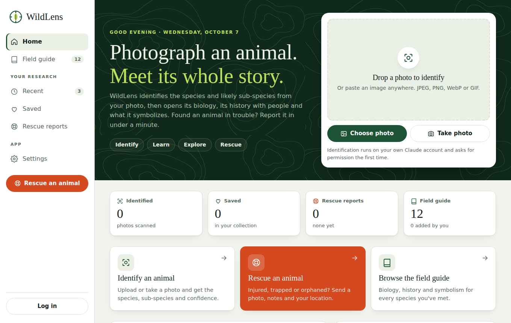
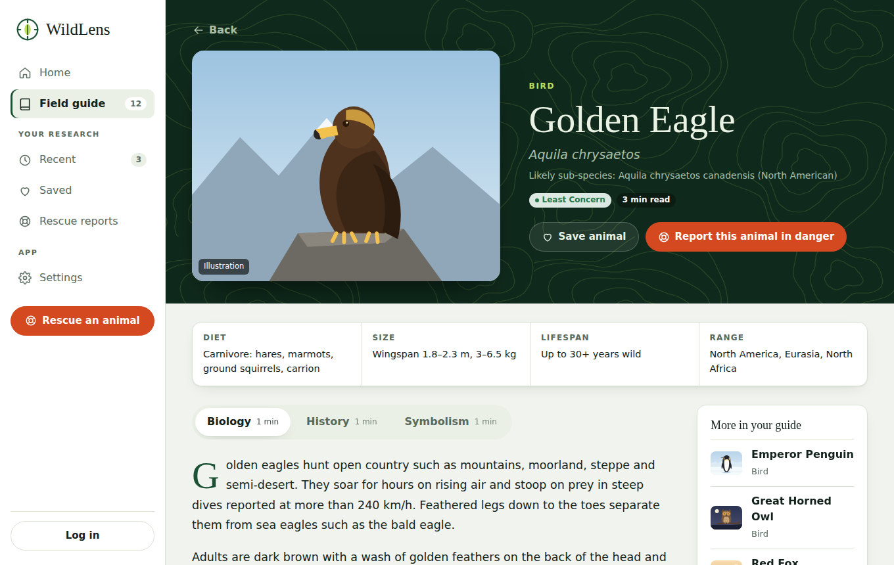
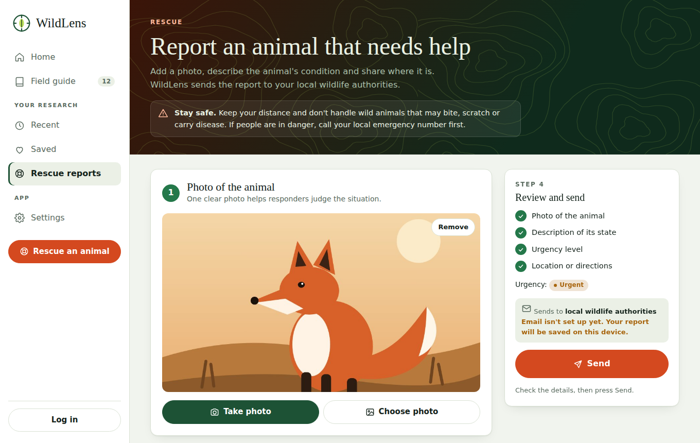
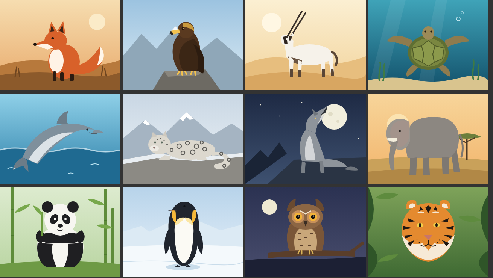

# WildLens

> The project lives in the [`wildlens/`](wildlens/) folder. This root `index.html` only forwards GitHub Pages visitors to the app.

**Identify · Learn · Explore**

WildLens is a web app concept. You photograph an animal, and the app identifies its species and likely sub-species. It then shows the animal's **biology**, its **history** with people, and what it **symbolizes**.

Target users: biology students, veterinarians and authors.

> **Status (7 Oct 2026):** a working client-side demo with a dashboard interface and a Rescue feature, live on GitHub Pages and as a Claude Artifact. It is not yet a full product. There is no backend, no real accounts, and no licensed photography yet. This README is the full hand-off for whoever picks up the project next.



---

## Contents

1. [Quick facts](#1-quick-facts)
2. [Repository layout](#2-repository-layout)
3. [Run, build and publish](#3-run-build-and-publish)
4. [Platform: how the demo runs](#4-platform-how-the-demo-runs)
5. [Screens and behavior](#5-screens-and-behavior)
6. [Animal identification](#6-animal-identification)
7. [Rescue reports](#7-rescue-reports)
8. [Data model](#8-data-model)
9. [Storage and persistence](#9-storage-and-persistence)
10. [Imagery: illustrations and photos](#10-imagery-illustrations-and-photos)
11. [Design system](#11-design-system)
12. [Code map](#12-code-map)
13. [Known limitations](#13-known-limitations)
14. [Path to a real product](#14-path-to-a-real-product)
15. [Open decisions](#15-open-decisions)
16. [Testing checklist](#16-testing-checklist)
17. [History of the project](#17-history-of-the-project)

---

## 1. Quick facts

| | |
|---|---|
| Public site | https://alhudaibibrahim-rgb.github.io/wildlens/ (GitHub Pages; browsing only, no photo scanning) |
| Repository | https://github.com/alhudaibibrahim-rgb/wildlens |
| Claude Artifact | `HLFppJgRoLnVniZQLvhj1K` (private to the owner's claude.ai account; share it from the page's Share menu). The only version where photo identification works |
| Deliverable | One self-contained HTML page, `dist/wildlens.html` (~170 KB) |
| Stack | Plain HTML, CSS and vanilla JavaScript. No framework, no bundler, no npm dependencies |
| External requests | Google Fonts only (Young Serif, Instrument Sans, IBM Plex Mono); plus the report endpoint once email is set up |
| AI | Claude, called from the page through the Artifact `sample` capability (no API key, no server) |
| Persistence | Browser `localStorage`, key `wildlens.v2` (per viewer, per browser) |
| Content | 12 hand-written animal profiles, 4–6 paragraphs per Biology / History / Symbolism tab (~6,500 words in total; draft quality, **not fact-checked**) |
| Imagery | 12 original SVG illustrations. Photo slots are ready but empty |
| Rescue reports | Photo + condition + device location + Send. **Email delivery is not configured yet** (`src/config.js`); reports are saved on the device and the email is previewed |
| Build tooling | Python 3 + Pillow (for photo processing only) |

---

## 2. Repository layout

```
wildlens/
├── README.md              ← this hand-off
├── index.html             ← built page with a full HTML skeleton; GitHub Pages serves this
├── .nojekyll              ← tells GitHub Pages to serve files as-is
├── src/
│   ├── shell.html         ← <title>, fonts, all CSS (design tokens), icon sprite, page markup for every screen
│   ├── config.js          ← RESCUE_CONFIG: where rescue reports are sent (not configured yet)
│   ├── art.js             ← ART: the 12 SVG illustrations + generic fallback
│   ├── data.js            ← ANIMALS: the 12 profiles; PHOTOS: licensed photo map (filled at build)
│   └── app.js             ← all behavior: routing, screens, storage, settings, identification, rescue
├── tools/
│   ├── build.py           ← concatenates src/ (config → art → data → app) → dist/wildlens.html, index.html
│   └── add_photo.py       ← crops/resizes a photo into photos/<id>.jpg and records its credit
├── photos/                ← licensed reference photos (empty; see §10)
├── photos.json            ← created by add_photo.py: {id: {src, credit}}
├── dist/
│   └── wildlens.html      ← the built page; this exact file is what gets published
└── docs/                  ← screenshots used in this README
```

The page has no `<!doctype>`, `<html>`, `<head>` or `<body>` tags. The Artifact platform wraps it in its own skeleton at publish time (see §4). `index.html` (and its copy `dist/preview.html`) adds a full skeleton so the page opens directly in a browser or on GitHub Pages.

---

## 3. Run, build and publish

### Run locally

```bash
python3 -I tools/build.py
open index.html                 # or double-click it; any modern browser works
```

Locally, everything works except **photo identification**. That feature needs the Claude Artifact runtime. Without it the page shows: *"Photo identification works when this page is opened on claude.ai."* Everything else runs offline, except that fonts fall back to system faces.

### Build

```bash
python3 -I tools/build.py
```

The build concatenates `src/shell.html` and a `<script>` block made of `art.js` + `data.js` + `app.js`. It also injects `photos.json` into `const PHOTOS = {};`. There is no minification or transpiling.

### Add photos

```bash
pip install pillow
python3 -I tools/add_photo.py ~/Downloads/fox.jpg red-fox "Photo: Jane Doe / Unsplash"
python3 -I tools/build.py
```

Use the animal `id` values from §8.

### Publish (Claude Artifact)

Publish `dist/wildlens.html` with the Artifact tool in a Claude session:

- `capabilities: { "sample": {} }` is required for identification.
- If photos exist, also publish them as supporting files: `files: { "photos/red-fox.jpg": "photos/red-fox.jpg", ... }`. The page references them by relative path.
- Republish from the same session/file path to keep the same URL. From a new session, pass the existing artifact URL as `url`.
- Artifact links are private to the owner until shared from the page's Share menu.

### Publish on GitHub Pages

The live repository uses this layout, because the project was uploaded as a folder:

```
<repo root>/
├── index.html      ← tiny redirect page: sends visitors to ./wildlens/
├── README.md       ← copy of this hand-off (links point into wildlens/)
└── wildlens/       ← the whole project, as described in §2
    └── index.html  ← the app itself
```

Settings used: **Settings → Pages → Build and deployment → Source: Deploy from a branch**, branch `main`, folder `/ (root)`. The site is served at `https://alhudaibibrahim-rgb.github.io/wildlens/`, and the root `index.html` forwards to `.../wildlens/wildlens/`.

To update the site: run `tools/build.py`, then upload the changed files (at least `wildlens/index.html`) to the same paths on GitHub. **Add file → Upload files** accepts folders dragged in from your computer and keeps their paths. GitHub Pages rebuilds automatically on every commit; progress shows under the **Actions** tab as "pages build and deployment".

Troubleshooting:

- **404 "File not found"**: GitHub can't find `index.html` in the folder Pages serves. File names are case-sensitive (`index.html`, not `Index.html`).
- **"Site not found"**: Pages hasn't built yet. Make any commit (for example, add a blank line to `README.md`) to trigger a build.
- **Source set to "GitHub Actions"**: switch it to **Deploy from a branch**; the Actions option needs a workflow file this project doesn't use.

Remember to run `tools/build.py` and commit `index.html` after every change to `src/`.

On GitHub Pages (or any other static host) `window.claude` does not exist, so **photo identification is unavailable** and the scan box shows the "works on claude.ai" message. Browsing the 12 profiles, Saved, Recent and Settings all work. A public site needs its own identification backend (see §14).

---

## 4. Platform: how the demo runs

The demo runs as a **Claude Artifact**: an HTML page hosted on claude.ai inside a locked-down frame. Rules that shaped the code:

| Platform rule | Effect on WildLens |
|---|---|
| External network is blocked (only listed CDNs for scripts and Google Fonts for CSS) | No image hot-linking, no API calls. All art is inline SVG; photos must ship as published files |
| `window.claude.use("sample")` lets the page ask Claude, billed to the **viewer's** account, with consent on first call | Identification needs no backend or API key. Each viewer approves once |
| `alert/confirm/prompt` don't work | All confirmations and errors are in-page messages and toasts |
| Camera APIs are refused | "Take photo" is a file input with `capture="environment"`, which opens the phone camera app instead |
| Location is refused inside claude.ai | Rescue falls back to typed directions there; on GitHub Pages (HTTPS) the browser asks for location permission normally |
| `localStorage` works but is per viewer, per browser | Used for saved/recent/settings; not shared or synced |
| Page is wrapped in a skeleton at publish | Source omits doctype/html/head/body; `<title>` and `<style>` sit at the top of `shell.html` |
| Viewer theme can be light, dark or "system" (`data-theme` on `<html>` or nothing) | All colors are CSS tokens defined for all three states |

Runtime contract at the time of writing: **0.2.66**.

---

## 5. Screens and behavior

All screens live in one page. Routing is in-memory (`go(view)` toggles `hidden` on `<section class="view">`).

**Navigation.** Desktop and tablet (over 900 px): a fixed left sidebar with Home, Field guide, Recent, Saved, Rescue reports and Settings, live counters on each item, an orange **Rescue an animal** button and the account area at the bottom. Phones: a dark top bar with the logo and account, and a bottom tab bar (Home, Guide, **Rescue** as a raised orange centre button, Saved, Settings).

Every screen opens with a dark "canopy" header band (forest green with a faint contour-map texture), then light working surfaces below.

| Screen | Section id | What it does |
|---|---|---|
| **Home (dashboard)** | `v-home` | Greeting with time of day and date; scan card (choose photo, take photo, click/drag/paste); four stat tiles (photos identified, saved, rescue reports sent/not sent, species in guide); three action cards (Identify, **Rescue**, Field guide); "Continue researching" list; "Field guide at a glance" with a conservation-status bar and legend; "Species of the day" |
| **Field guide** | `v-guide` | All built-in and identified species as photo tiles with status pill, saved heart and reading time; search, category chips, status filter |
| **Animal Lore** | `v-lore` | Header with large image, name, scientific name, sub-species, status pill, reading time, match-confidence meter (after a scan), **Save** and **Report this animal in danger** (opens Rescue with the species filled in); fact strip (Diet, Size, Lifespan, Range); Biology / History / Symbolism tabs with per-tab reading time and drop-cap reading column; "More in your guide" sidebar |
| **Recent** | `v-recent` | Timeline grouped by day (Today, Yesterday, dates), search and category chips, Clear history |
| **Saved** | `v-saved` | Tile grid of the viewer's collection; designed empty state |
| **Rescue** | `v-rescue` | Report an animal in danger: photo → condition → location → review and **Send** (§7); list of past reports with status |
| **Settings** | `v-settings` | Grouped cards: Appearance (theme, reduce motion, language), Privacy and history (history toggle, delete all data with in-page confirmation), Rescue reports (email delivery status and recipients, read-only), Notifications (cosmetic) |
| **Log in** | `v-login` | Email/password + "Continue with Google". **Demo only**: accepts anything, stores just a display name |

Deep links: `#<animal-id>` (for example `#snow-leopard`) opens that profile; `#rescue` opens the Rescue screen.



---

## 6. Animal identification

**Where:** `identify(file)` in `src/app.js`.

**Flow**

1. Viewer supplies an image (picker, camera, drop or paste). Non-images are rejected immediately.
2. The photo appears in the scan box with an animated reticle (disabled by Reduce motion / `prefers-reduced-motion`) and a **Stop** button (`AbortController`).
3. The page checks `sample` is available and that `sample.limits().images` exists.
4. It calls `sample.json(prompt, { images: [file], modelTier: "default", signal })`.
5. On success:
   - `isAnimal: false` → shows "No animal found" with Claude's one-line reason.
   - `matchId` is one of the 12 ids → opens that rich built-in profile.
   - Otherwise → builds a **new profile** (id `x-<scientific-name-slug>`), marked "New profile" with a "check key facts" note.
   - A 640 px JPEG thumbnail of the viewer's photo is stored and replaces the illustration for that animal.
   - The confidence score shows as a meter on the Lore page.

**Requested JSON (verbatim shape in the prompt)**

```json
{
  "isAnimal": true,
  "reason": "only when isAnimal is false",
  "matchId": "snow-leopard | ... | null",
  "name": "Common name",
  "sci": "Scientific name",
  "sub": "Likely sub-species or population, or empty",
  "confidence": 0,
  "cat": "Mammal | Bird | Reptile | Amphibian | Fish | Insect | Other",
  "facts": { "Diet": "", "Size": "", "Lifespan": "", "Range": "", "Status": "IUCN status in words" },
  "biology": ["4–5 paragraphs"],
  "history": ["4–5 paragraphs"],
  "symbolism": ["4–5 paragraphs"]
}
```

When `matchId` is set, the prompt asks for empty text fields so the call stays fast. All returned values are coerced to strings and capped (max 6 paragraphs per tab) before rendering. All text is HTML-escaped (`esc()`).

**Error handling** (`ERR` map in `app.js`; the page never auto-retries)

| Code | Message shown |
|---|---|
| `unavailable` (no runtime) | Works when opened on claude.ai; browse entries instead |
| `not_granted` | Needs permission; reload and allow |
| `sampling_disabled` / `capability_disabled` / `not_declared` | Not available on this account/view |
| `images_unavailable` | This view can't send photos |
| `image_rejected` | Use JPEG/PNG/WebP/GIF under 20 MB |
| `rate_limited` | Wait a minute and retry |
| `session_expired` | Sign in to Claude again |
| `refused` / `empty_completion` | Try a different/clearer photo |
| `invalid_json` | Answer incomplete; try again |
| `cancelled` | Silent reset (viewer pressed Stop) |
| anything else | Generic "try again in a moment" |

---

## 7. Rescue reports

Lets anyone report a wild animal that is injured, trapped, orphaned or otherwise in danger, and send the report to local wildlife authorities by email.



### Flow (`v-rescue`)

| Step | What the user does | Notes |
|---|---|---|
| 1. Photo | **Take photo** (opens the phone camera via `capture="environment"`), **Choose photo**, drag-and-drop, or paste | Resized in the browser to max 1280 px JPEG before use |
| 2. Condition | Animal name (optional; an **Identify** button fills it using Claude when available), situation chips (Injured, Trapped or entangled, Orphaned or alone, Sick or weak, On a road, Oiled or polluted, Attacked by a pet, Other), urgency (Stable / Urgent / Critical), description (10–1,000 characters), optional name and phone | |
| 3. Location | **Use my current location** (browser Geolocation API, high accuracy, 15 s timeout) shows coordinates, accuracy and an "Open in Maps" link; a free-text **Landmarks or directions** field works with or without coordinates | Location needs HTTPS and the user's permission. It is **always blocked inside claude.ai previews**, so there the user types the place |
| 4. Review and send | A checklist (photo, description, urgency, location or directions) enables the orange **Send** button; the panel shows who the report goes to | Sticky on desktop, inline on phones |

After Send, a result card shows the outcome, the full **email preview** and a **Copy report text** button. Every report is listed under "Your reports" with a status pill: *Sent*, *In email app*, *Failed* or *Saved · not sent*. Reports get an id like `WL-261007-9O24`.

The screen opens with a safety notice: keep your distance, don't handle wild animals, and call the local emergency number first if people are in danger.

### Email delivery: not configured yet

All settings live in **`src/config.js`**:

```js
const RESCUE_CONFIG = {
  provider: "none",          // "none" | "mailto" | "endpoint"
  to: [],                    // e.g. ["wildlife@your-authority.gov"]
  endpoint: "",              // provider "endpoint": URL that accepts multipart/form-data POST
  subjectPrefix: "[WildLens Rescue]",
  authorityName: "local wildlife authorities"
};
```

| `provider` | What Send does | Photo | Needs |
|---|---|---|---|
| `"none"` (current) | Saves the report on the device, marks it *Saved · not sent*, shows the email it would send | Kept on device | Nothing |
| `"mailto"` | Opens the user's email app with recipients, subject and body filled in; marked *In email app* | **Not attached** (mail links can't carry files); the email says so | At least one address in `to` |
| `"endpoint"` | POSTs the report to a form/email service or your own API; marked *Sent* on HTTP 2xx, *Failed* otherwise | **Attached** as `photo` (JPEG) | `endpoint` URL |

Fields sent to an endpoint (multipart/form-data): `_subject`, `to`, `message` (the full email text), `report_id`, `urgency`, `species`, `latitude`, `longitude`, `accuracy_m`, `photo`. This shape works directly with form-to-email services such as Formspree, Getform or Basin, or with a small serverless function (for example one that calls an email API). A published Claude Artifact cannot reach outside servers, so the `endpoint` option only works on GitHub Pages or another normal host.

Email format:

```
Subject: [WildLens Rescue] Urgent: Red fox needs help near <directions or coordinates>

WildLens rescue report WL-261007-9O24
Urgency:   Urgent
Animal:    Red fox
Situation: Injured, On a road
Reported:  Oct 7, 2026, 5:58 PM

CONDITION
<user's description>

LOCATION
Coordinates: 24.71360, 46.67530 (accuracy about ±12 m)
Map: https://www.google.com/maps?q=24.713600,46.675300
Directions: <landmarks>

REPORTER
Name:  <optional>
Phone: <optional>

Photo: attached.
```

### Choosing recipients ("local authorities")

The app does not yet look up which authority covers the user's location. Options for later: one national address in `to`; a table of regions to addresses chosen from the coordinates; or an endpoint that routes reports server-side. Confirm with each authority that it accepts emailed reports and what details it needs.

### Privacy

Reports include the photo, location and any name/phone the user enters. They are stored only in that browser (key `wildlens.v2`, max 50 reports; photo kept as a 320 px thumbnail) until delivery is set up. Users can delete everything from Settings.

---

## 8. Data model

### Built-in profiles (`ANIMALS` in `src/data.js`)

```js
{
  id: "snow-leopard",            // stable key: storage, photos, deep links
  name: "Snow Leopard",
  sci: "Panthera uncia",
  sub: "No widely agreed sub-species",
  cat: "Mammal",                 // drives Recent filters
  facts: { Diet, Size, Lifespan, Range, Status },   // Status drives the colored pill
  biology:   ["paragraph", ...],
  history:   ["paragraph", ...],
  symbolism: ["paragraph", ...]
}
```

| id | Name | Scientific name | IUCN status used |
|---|---|---|---|
| `red-fox` | Red Fox | *Vulpes vulpes* | Least Concern |
| `golden-eagle` | Golden Eagle | *Aquila chrysaetos* | Least Concern |
| `arabian-oryx` | Arabian Oryx | *Oryx leucoryx* | Vulnerable |
| `green-sea-turtle` | Green Sea Turtle | *Chelonia mydas* | Endangered |
| `bottlenose-dolphin` | Bottlenose Dolphin | *Tursiops truncatus* | Least Concern |
| `snow-leopard` | Snow Leopard | *Panthera uncia* | Vulnerable |
| `gray-wolf` | Gray Wolf | *Canis lupus* | Least Concern |
| `african-elephant` | African Elephant | *Loxodonta africana* | Endangered |
| `giant-panda` | Giant Panda | *Ailuropoda melanoleuca* | Vulnerable |
| `emperor-penguin` | Emperor Penguin | *Aptenodytes forsteri* | Near Threatened |
| `great-horned-owl` | Great Horned Owl | *Bubo virginianus* | Least Concern |
| `bengal-tiger` | Bengal Tiger | *Panthera tigris tigris* | Endangered |

Status pill colors: Least Concern = green; Near Threatened / Vulnerable = amber; Endangered / Critically Endangered = red; anything else = neutral.

### Generated profiles

These have the same shape plus `generated: true`. They are kept in `state.custom` and persisted (see §9).

### Photos (`PHOTOS`, injected at build from `photos.json`)

```js
{ "red-fox": { "src": "photos/red-fox.jpg", "credit": "Photo: Jane Doe / Unsplash" } }
```

Image priority everywhere (cards, chips, Lore): **viewer's own scan photo → licensed photo → SVG illustration**. The credit label on the Lore image reads "Your photo", the stored credit, or "Illustration".

---

## 9. Storage and persistence

Single `localStorage` key: **`wildlens.v2`** (all reads and writes wrapped in try/catch; the app works in memory if storage is blocked).

```js
{
  saved:    ["snow-leopard", ...],                 // ids, newest first
  recent:   [{ id, at: <ms timestamp> }, ...],     // max 60; skipped when history is off
  custom:   { "x-ursus-arctos": { ...profile } },  // generated profiles
  photos:   { "<id>": "data:image/jpeg;base64,..." }, // viewer scan thumbnails (640 px)
  reports:  [{ id, createdAt, species, situations, urgency, comment, name, phone,
               place, loc: { lat, lon, acc, at } | null, status, note, thumb, mail }], // max 50, newest first
  scanCount: 0,                                     // photos identified (Home stat tile)
  settings: { theme: "auto", history: true, motion: false, updates: true, email: false, lang: "English" },
  user:     "email@example.com" | null            // demo login display name only
}
```

Not persisted: match confidence (per session only).

**Limits to know:** data lives only in that browser, it is lost if site data is cleared, and photo thumbnails can fill the ~5 MB quota after many scans. When that happens, the app first drops the photos of older rescue reports and retries; if storage is still full, the session keeps working in memory and the rescue result card warns the user. For shared or synced collections, move to the Artifact `db` capability or a real backend (§14).

---

## 10. Imagery: illustrations and photos

**Current:** 12 original flat-style SVG portraits in `src/art.js` (`ART.get(id, label)`), each a 320×240 habitat scene. Unknown species get a generic leaf-and-compass mark. Gradient ids are made unique per render so repeated images don't collide.



**Wanted (the founder's request):** realistic photos, for example a natural-light portrait of the animal in its habitat. The photo pipeline is built; photos just need sourcing.

How to finish it:

1. Get one photo per animal from a source whose license allows use in an app, for example **Unsplash** or **Pexels** (free license), **Wikimedia Commons** (check each file: CC BY / CC BY-SA need attribution, CC0 / PD don't), or **iNaturalist** (CC-licensed observations only).
2. Record photographer, source URL and license for each in a credits list (add `CREDITS.md`).
3. Run `tools/add_photo.py` for each, then `tools/build.py`, then publish with `photos/` as supporting files.

Photo guidance: animal clearly in frame and roughly centered, landscape, at least 1200 px wide. The crop is 4:3, biased slightly toward the top (`centering=(0.5, 0.45)`). Output is ~100 KB per photo, so all 12 add ~1.2 MB.

The cloud sandbox used to build this demo could not download from Wikimedia, Unsplash, Pexels or iNaturalist (outbound access blocked). Photos must be supplied by a person or fetched from a machine with normal internet access.

---

## 11. Design system

Direction: a **field-station dashboard**. Dark forest "canopy" header bands with a faint contour-map texture carry each screen's title; light, calm working surfaces sit below. Lime is the highlight on dark; orange ("ember") is reserved for Rescue so it always reads as the urgent action. All tokens live in `src/shell.html` `:root`.

| Token | Light | Dark | Use |
|---|---|---|---|
| `--bg` | `#F1F4EE` | `#0B120E` | Page ground |
| `--surface` / `--surface-2` | `#FFFFFF` / `#EBF0E6` | `#131C16` / `#19241D` | Cards / inputs, chips, meters |
| `--ink` / `--muted` | `#13221A` / `#58695D` | `#E3EBE2` / `#97A79A` | Text |
| `--line` | `#DAE2D4` | `#24312A` | Borders |
| `--forest` | `#1D5235` | `#82C79A` | Primary buttons, links, active nav |
| `--canopy` | `#0F2A1C` | `#081A10` | Header bands, phone top bar |
| `--lime` | `#BCE05C` | `#C8EA6E` | Highlights on dark (eyebrows, headline accent, scan reticle) |
| `--ember` | `#D4491F` | `#F1754B` | Rescue only: buttons, action card, tab-bar button |
| `--ok` / `--warn` / `--bad` | green / amber / red | lighter in dark | IUCN status pills, urgency, report status |
| `--contours` | SVG data URI | same | Contour texture behind header bands |

- **Type:** *Young Serif* (logotype, headings, stat numbers, drop caps), *Instrument Sans* (UI and body), *IBM Plex Mono* (coordinates, report ids, email preview). Google Fonts with system fallbacks.
- **Icons:** one inline SVG sprite at the top of `shell.html` (`<symbol id="i-…">`), used as `<svg class="ico"><use href="#i-scan"/></svg>`; stroke icons follow text color.
- **Components:** stat tiles, action cards, photo tiles with status pills, list rows, segmented controls, switches, chips, numbered step cards, sticky review panel, toasts.
- **Layout:** sidebar 252 px + content (max 1180 px). Under 900 px: top bar + bottom tab bar; grids drop to two columns under 520 px. Every grid track uses `minmax(0, …)` so long content never causes sideways scrolling (checked at 390 px on every screen).
- **Theme:** tokens defined on `:root`, redefined under `@media (prefers-color-scheme: dark)` (guarded by `:not([data-theme="light"])`) and under `[data-theme="dark"]`. The in-app theme setting sets or removes `data-theme`.
- **Accessibility:** visible focus rings, keyboard-operable drop zones, `aria-current`/`aria-selected`/`aria-pressed` on nav, tabs, chips and toggles, alt text on photos, labelled SVGs, `role="status"` toasts, reduced-motion support (system setting or in-app toggle).

---

## 12. Code map

Build order: `config.js` → `art.js` → `data.js` → `app.js`, inside one `<script>`. `src/app.js` is one IIFE. Main parts, in file order:

| Area | Key functions |
|---|---|
| Storage | `state`, `load()`, `save()` (with storage-full fallback) |
| Lookups | `byId(id)`, `allAnimals()`, `statusClass()`, `picHTML(a)`, `creditFor(id)`, `readMins()` |
| Routing | `go(view, arg)` (renders the screen, sets `aria-current` in sidebar and tab bar, remembers `prevView`), `openAnimal(id)`, `renderCounts()` |
| Account (demo) | `renderAcct()` (sidebar + phone top bar), login handlers |
| Shared UI | `tile(a)`, `row(a, meta)`, `empty(...)`, `toast()`, `icon(id)`, `ago()`, `fmtDate()` |
| Screens | `renderHome()`, `renderGuide()`, `renderLore(id)`, `renderRecent()`, `renderSaved()`, `renderSettings()`, `applySettings()` |
| Identification | `samplePromise`, `imageSampler()`, `identify(file)`, `shrink(file, max)`, `ERR` map |
| Rescue | `draft`, `renderRescue()`, `renderLoc()`, `getLocation()`, `renderSummary()`, `setRescuePhoto(file)`, `mailCfg()`, `composeEmail(r)`, `sendReport()`, `showResult(r)`, `renderReports()` |
| Boot | `applySettings(); renderAcct(); go("home");` plus `#id` / `#rescue` deep links |

Global click delegation: `data-go="<view>"` navigates, `data-open="<id>"` opens a profile, `data-act="identify"` opens the photo picker. Paste anywhere adds the image to Rescue when that screen is open, otherwise starts identification.

---

## 13. Known limitations

- **No real photos yet.** Illustrations stand in (§10).
- **Profile text is a draft.** It was written for the demo and needs review by a biologist or subject-matter expert before real use, especially figures (sizes, lifespans, population counts) and cultural claims in Symbolism.
- **Generated profiles are AI-written** and may contain errors. The UI says so on every generated page.
- **Rescue email is not configured** (§7). Until `src/config.js` is set up, Send only saves the report on the device. Recipients ("local authorities") are not chosen automatically by location.
- **Device location** needs HTTPS and permission, and is always blocked inside claude.ai previews; users type directions instead. Accuracy depends on the device (GPS outdoors is best).
- **Login, Google sign-in, email digest, product updates and language are cosmetic.** No accounts, no email, no translations.
- **Persistence is per browser** (§9); nothing syncs between devices or users.
- **Identification only works on claude.ai**, costs the viewer's own Claude usage, and asks for consent on first use.
- **Confidence is the model's self-report**, not a calibrated probability.
- **No analytics, tests or CI.**

---

## 14. Path to a real product

Suggested order. Each step works without the next.

1. **Content quality.** Fact-check the 12 profiles with sources; add a `sources` array per profile and show citations on the Lore page.
2. **Photography.** Source and credit 12 licensed photos (§10); add `CREDITS.md`.
3. **Shared data inside the Artifact.** Move saved/recent/generated profiles from `localStorage` to the Artifact `db` capability (per-user docs under `data/users/<id>/`) so collections follow the viewer across devices.
4. **Real hosted app.** This is where the demo becomes a product:
   - **Frontend:** keep this UI, or port it to React/Next.js; screens map one-to-one.
   - **Identification API:** a server endpoint that calls the Anthropic Messages API with the image and the same JSON contract as §6. Consider adding a dedicated vision model or the iNaturalist computer-vision API for first-pass species ID, with Claude for the narrative.
   - **Facts data:** pull taxonomy and ranges from **GBIF**, conservation status from the **IUCN Red List API** (needs a token), and observations/photos from **iNaturalist**. Cache results.
   - **Accounts:** real auth (e.g., Google OAuth, email magic link), a database for collections and history, and image storage for user photos.
   - **Privacy:** user photos may carry GPS EXIF data (strip it on upload) and may show sensitive locations of endangered species (consider hiding exact locations).
5. **Mobile.** Decide between a PWA (fastest, keeps one codebase) and native apps (better camera UX, offline).
6. **Monetization** is not scoped (ideas raised: free tier + education/clinic plans).

---

## 15. Open decisions

| Decision | Options | Notes |
|---|---|---|
| Photo source | Founder supplies / stock site / in-app "Set photo" manager | The manager would use the Artifact `assets` capability, which limits sharing to the owner's organization |
| Stay an Artifact demo or build a hosted app | Artifact (fast, free to host, AI billed to viewers) vs. hosted (own API costs, real accounts) | See §14.4 |
| Animal catalogue size | 12 hand-written vs. many generated on demand | Hand-written profiles need review; generated ones need disclaimers |
| Repository license | MIT / proprietary / other | **Not chosen.** Add a `LICENSE` before making the repo public |
| Languages | English only vs. Arabic and others | The UI already has a language dropdown; RTL support would be needed for Arabic |

---

## 16. Testing checklist

Run before every publish (no automated tests exist yet):

- [ ] `python3 -I tools/build.py` succeeds; `node -e "new Function(require('fs').readFileSync('src/app.js','utf8'))"` reports no syntax errors.
- [ ] `index.html` opens; Home, Recent, Saved, Settings and Log in all render.
- [ ] Each of the 12 chips opens its Lore page; all three tabs show text.
- [ ] Save / remove updates Saved; reload keeps it.
- [ ] Recent search and category filters work; Clear history empties it; turning history off stops recording.
- [ ] Theme Light / Dark / Auto all look right; Reduce motion stops the reticle animation.
- [ ] At 390 px wide: top bar and bottom tab bar visible (Rescue button raised in the centre), no horizontal scroll on any screen, two-column grids.
- [ ] Rescue: Send stays disabled until photo, description (10+ characters), urgency and location-or-directions are filled; the checklist ticks as each is done.
- [ ] Rescue on a phone over HTTPS (GitHub Pages): Take photo opens the camera; Use my current location asks permission and shows coordinates and an Open in Maps link; denying it shows the "describe the place" message.
- [ ] Rescue Send with `provider: "none"`: result card says "saved on this device and not sent", shows the email preview, Copy works, the report appears under Your reports and in the Home tile and sidebar counter, and survives a reload.
- [ ] "Report this animal in danger" on a Lore page opens Rescue with the species filled in.
- [ ] Settings → Delete all data asks for confirmation and clears saved, history and reports.
- [ ] On claude.ai: first scan shows the consent prompt; a clear animal photo opens the right profile; a non-animal photo shows "No animal found"; Stop cancels cleanly.
- [ ] With photos added: each Lore image shows its credit; chips and cards show photos.

---

## 17. History of the project

1. The founder supplied 7 screen mockups (Log-in, Home, Animal Lore with Biology/History/Symbolism tabs, Settings, Recent Research, Saved Animals) and a WildLens logo (compass/leaf over a phone in a book).
2. The first demo was built and published as Artifact `XtMkXstThsf4wHirgu5z18`. That link is no longer reachable from the current account, and its source file was not carried over.
3. **30 Sep 2026:** demo rebuilt from the written hand-off and published as `HLFppJgRoLnVniZQLvhj1K`. Changes: emoji replaced with 12 original illustrations; saved/recent/settings now persist in the browser.
4. **7 Oct 2026:** founder asked for realistic photos instead of illustrations. Photo slots, credits and `tools/add_photo.py` were added; photos are waiting to be supplied. This repository and README were prepared for GitHub, and the site went live on GitHub Pages.
5. **7 Oct 2026:** Biology, History and Symbolism were expanded from 2 paragraphs to 4–6 paragraphs per animal (anatomy, diet, behavior and breeding; key dates, people and conservation milestones; myths, emblems and literature). The identification prompt now asks Claude for 4–5 paragraphs per tab for newly identified species.
6. **7 Oct 2026:** **Rescue an animal** added: photo, condition, urgency, device location and Send, with email delivery prepared but not configured (`src/config.js`). Whole interface redesigned as a field-station dashboard: sidebar navigation (bottom tab bar on phones with a central Rescue button), dark contour header bands, stat tiles, action cards, status chart, field-guide screen with filters, new Lore layout and grouped Settings.

The project's claude.ai Project ("old/new project, ibrahim's Dock") also keeps a copy of the built page (`claude/wildlens-demo.html`) and a short status note (`claude/wildlens-status.md`).
